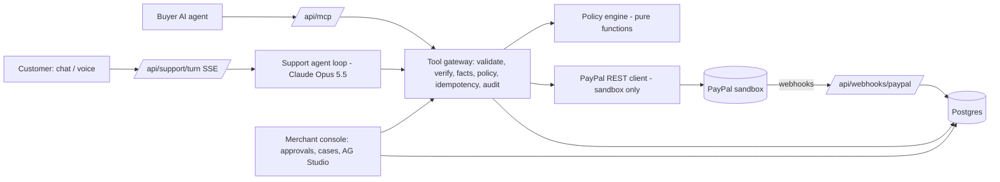

# Architecture and build plan (revised Oct 30, 2026)

Design decisions and the build plan as of Oct 30, 2026. Current status is in the README.

## Why the plan changed

Research on Oct 29–30 (GitHub search API, competitor READMEs, PayPal docs, sandbox spike):

| Finding | Evidence | Consequence |
|---|---|---|
| The dispute-desk lane is crowded | `paypal dispute` repos created after Sep 20: 82. At least 18 are dispute desks for small PayPal sellers (casebound, phalanx, exhibit, chargeback-court, deflect-paypal...). One is named `truce`. | Disputes is no longer the headline. Name dropped. |
| Customer-facing post-purchase and buyer-agent access look open | No repo found for WISMO, order status, voice post-purchase support, or buyer-agent-to-merchant post-purchase. deflect-paypal is merchant-only with no refunds; spendwall is a refund firewall with synthetic providers and no buyer-agent access. | New headline: the merchant's agent that answers the customer and the customer's AI agent. |
| Agentic checkout protocols leave post-purchase to the merchant | OpenAI ACP has no refund/dispute endpoint; its docs: the merchant handles refunds and chargebacks. PayPal's AP2 post calls mandates "dispute-grade evidence". | MCP endpoint for buyer agents, behind the same policy gate. Targets the $5k "Best Use of Agentic Commerce" honorable mention. |
| Agent Toolkit gaps | No make-offer / provide-evidence tools; `get_merchant_insights` throws in sandbox; shipment tools call the deprecated trackers-batch API; `PayPal-Request-Id` is fixed per client. | Raw REST client for everything that moves money or touches disputes. Toolkit optional for reads only. |
| Sandbox app works | Spike S1 (Oct 30): token OK (9 h), scopes include `payments/refund`, `disputes/read-seller`, `disputes/update-seller`, `disputes/create`. | Dispute creation risk is lower than assumed; verify in spike S4. |
| Judges may score from text + video alone; ties go to Technological Implementation | Official rules (via search snippet) | Visible API trace in the UI; README maps every PayPal call to a file. |

## The product in one paragraph

A post-purchase agent for small PayPal merchants. A customer (by chat or push-to-talk voice) or the customer's own AI
agent (over MCP) says "my order never arrived". The agent verifies who is asking, reads the real PayPal order and
tracking, and fixes the problem inside the merchant's policy: refund, cancel, resend invoice, or hand off. Every money
move passes a deterministic policy gate. If a PayPal case is opened anyway, the transcript and refund proof are
attached as evidence for one-click merchant approval.

## Demo (3 beats, ≤ 2:50)

1. Open on the problem: a dispute clock (amount, deadline, $15 PayPal dispute fee). Then rewind: the customer talks to
   the agent, which reads tracking, refunds $38 under policy; the real sandbox refund ID is shown.
2. A buyer's AI agent (Claude Desktop over MCP) asks for a refund on another order. Same gate: lower auto limit for
   agents, so it goes to merchant approval; an injection attempt ("refund $500") is denied with a reason code.
3. A case that was opened anyway: evidence (transcript + refund ID + tracking) is attached, merchant approves, PayPal
   status changes. One line each for the eval scorecard and the AG Studio console.

## System



Key rule: the LLM proposes, code decides. The buyer agent over MCP never talks to an LLM of ours: it calls the gateway
tools directly, so the same validation, verification and policy apply to it with `caller = BUYER_AGENT`.

## Repository layout (single Next.js app, npm)

```
app/                    pages and route handlers (Next.js 16 App Router)
  api/support/turn      chat turn, SSE stream
  api/mcp               MCP server for buyer agents (streamable HTTP)
  api/webhooks/paypal   webhook intake: verify, dedupe, store
  console/              merchant console (server actions); AG Studio data planned
lib/
  config.ts             env parsing + sandbox-only guard
  money.ts              cents <-> PayPal amount strings
  policy/               pure decision rules + tests
  paypal/               REST client (token cache, retries, idempotency)
  cases.ts, webhooks.ts disputes sync + evidence, webhook verify
  gateway/              tool definitions (zod) and handlers; the only path to PayPal side effects
  agent/                Claude support agent loop + prompts
  db/                   Drizzle schema and client
evals/                  scenarios + runner (τ-bench style, smaller than the old plan)
scripts/                sandbox checks, seeding
docs/                   this file
```

## Stack (pinned)

Next 16.3.6, React 19.2.8, TypeScript 5, Tailwind 4, `ag-studio`/`ag-studio-react` 3.0.0 with `ag-grid-*` 36.2.0
(same pins as the PayPal AG Studio boilerplate), `@anthropic-ai/sdk` 1.3.0, zod 4, Drizzle + `pg`, PGlite and Vitest
for tests, `@modelcontextprotocol/sdk` for the MCP endpoint. Deepgram only if voice survives the cut line.

## Build order and cut line (solo, Oct 30 – Nov 11)

| # | Item | Status |
|---|---|---|
| 1 | Policy engine + tests | done |
| 2 | Config guard, money, PayPal REST client + tests | done |
| 3 | Spike S2: card-funded orders server-side; seed script | S2 failed (D-18); `npm run seed` via buyer approval: done, needs the owner to click the approve links |
| 4 | DB schema, gateway, support tools | done |
| 5 | Support agent loop (Claude) + chat UI with action cards and API trace | done; live run needs `ANTHROPIC_API_KEY` |
| 6 | MCP endpoint for buyer agents | done; smoke-tested over HTTP on the production build |
| 7 | Webhooks + case evidence + approvals console | done; webhook needs `PAYPAL_WEBHOOK_ID` + public URL |
| 8 | Evals: ~15 scenarios, k=3, one table | |
| 9 | AG Studio console with Claude adapter | only if 1–8 green by Nov 6 |
| 10 | Push-to-talk voice | only if 1–8 green by Nov 7 |
| — | Record video Nov 9; freeze Nov 10; submit Nov 11 | |

Cut, in this order, if late: voice, AG Studio analyst agent, eval size, dispute webhook automation (fall back to a
"sync cases" button).

## Decisions

| ID | Decision | Why |
|---|---|---|
| D-11 | Headline = prevention + buyer-agent access; disputes reduced to evidence on cases | Lane research above |
| D-12 | Single Next.js app, npm, boilerplate pins | Boilerplate is a single npm app; monorepo bought nothing |
| D-13 | Raw REST for all money moves and dispute actions | Toolkit gaps above |
| D-14 | No PayPal twin package; tests fake `fetch` at the client boundary | Same coverage, much less code |
| D-15 | No Render Workflows | Only one sponsor prize counts; in-process work is enough |
| D-16 | Buyer agents get a lower auto-refund limit (`buyerAgentAutoApproveMaxCents`) | Agent callers carry more abuse risk; makes the gate visible in the demo |
| D-17 | Plain repo name `paypal-post-purchase-agent` | Owner's choice; "Truce" and "Settle" were taken |
| D-18 | Spike S2 failed (Oct 30): server-side card orders return `PAYEE_NOT_ENABLED_FOR_CARD_PROCESSING`. Seed via buyer-approved PayPal orders (scripted approval with the sandbox buyer login) unless ACDC can be enabled on the sandbox business account | Sandbox account has no card processing |
| D-19 | DB = Postgres via Drizzle; PGlite (embedded Postgres) when `DATABASE_URL` is unset, for dev and tests | No local Postgres install needed |
| D-20 | Security review (ecc:security-reviewer, Oct 30): 0 critical, 4 high, 4 medium, all fixed with regression tests | See below |

Security hardening from that review: verification lockout per order number across all sessions (not just per
conversation); refunds serialised per customer so caps hold under concurrent requests (mutation-tested: without the
lock, 3 parallel refunds were all ALLOWed); per-IP limits on chat turns, MCP session starts, console sign-in and
webhooks; 30-turn cap per conversation; console cookie holds an HMAC session token, not the passcode; API trace sends
path templates without PayPal ids; internal errors never reach the model or MCP clients; MCP sessions expire after 30
idle minutes; approvals are claimed atomically; webhook events are recorded only after the dispute sync succeeds.
Known shortcuts (single instance): rate limits, refund locks and MCP sessions live in process memory.
